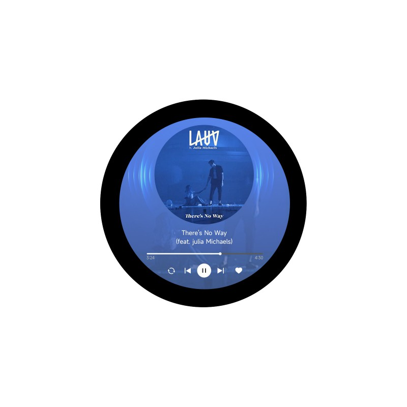

  <h1>ESP32-S3-Touch-LCD-1.85</h1>
  
<strong>ESP32-S3 development board with a 1.85-inch 360 × 360 round capacitive touch display</strong>

  
<strong>English</strong> | <a href="README_ZH.md">简体中文</a>

  

    
    
  

  

    <a href="https://www.waveshare.com/esp32-s3-touch-lcd-1.85.htm?sku=28514">🛒 Product</a> &middot;
    <a href="https://github.com/waveshareteam/ESP32-S3-Touch-LCD-1.85/releases/latest">📦 Firmware</a> &middot;
    <a href="examples/esp-idf/">🧩 ESP-IDF</a> &middot;
    <a href="https://docs.waveshare.com/ESP32-S3-Touch-LCD-1.85">📖 Documentation</a>
  

  

---

## ✨ Overview

The ESP32-S3-Touch-LCD-1.85 (SKU 28514) is a round-screen ESP32-S3 board with capacitive touch, motion sensing, a real-time clock and audio interfaces. This repository provides the board's ESP-IDF peripheral test application.

| Feature | Device / interface |
| --- | --- |
| MCU | ESP32-S3 |
| Memory | 16 MB Flash, 8 MB PSRAM |
| Display | 1.85-inch, 360 × 360, QSPI, ST77916 |
| Touch | CST816, I²C |
| Motion and time | QMI8658 IMU, PCF85063 RTC |
| Audio and storage | Microphone, PCM5101 audio output, microSD slot |

## 📦 Quick Start

1. Connect the board to your computer with a USB data cable.
2. Follow the [ESP-IDF example instructions](examples/esp-idf/ESP32-S3-Touch-LCD-1.85-Test/) to build and flash the project.

Download example firmware from [Releases](https://github.com/waveshareteam/ESP32-S3-Touch-LCD-1.85/releases) when a package is available.

## 🧪 Examples

### ESP-IDF

| Example | Main feature |
| --- | --- |
| [Peripheral test](examples/esp-idf/ESP32-S3-Touch-LCD-1.85-Test/) | Touchscreen dashboard, SD card music playback and voice commands |

## 🛠️ Development Environment

| Framework | Version | Examples |
| --- | --- | ---: |
| ESP-IDF | `v5.3.2` | 1 |

## 📚 Resources

- [Schematic](hardware/schematic/)
- [Product page](https://www.waveshare.com/esp32-s3-touch-lcd-1.85.htm?sku=28514)
- [Wiki](https://docs.waveshare.com/ESP32-S3-Touch-LCD-1.85)

## 🤝 Support

- Example or repository problems: [open an issue](https://github.com/waveshareteam/ESP32-S3-Touch-LCD-1.85/issues/new/choose).
- Product and hardware questions: [Waveshare support](https://service.waveshare.com/).

## 📄 License

Third-party components retain their respective license terms and notices.
