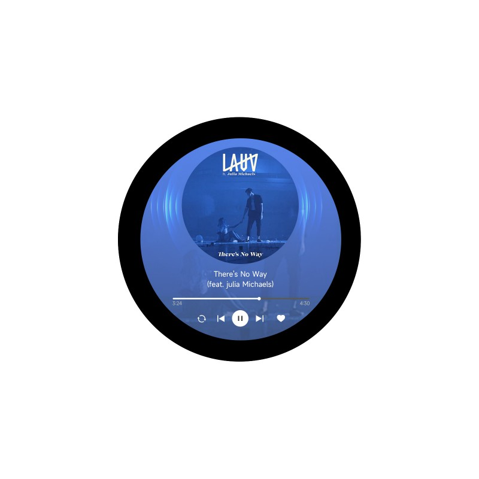

  <h1>ESP32-S3-Touch-LCD-1.85</h1>
  
<strong>配备 1.85 英寸 360 × 360 圆形电容触摸屏的 ESP32-S3 开发板</strong>

  
<a href="README.md">English</a> | <strong>简体中文</strong>

  

    
    
  

  

    <a href="https://www.waveshare.com/esp32-s3-touch-lcd-1.85.htm?sku=28514">🛒 产品</a> &middot;
    <a href="https://github.com/waveshareteam/ESP32-S3-Touch-LCD-1.85/releases/latest">📦 固件</a> &middot;
    <a href="examples/esp-idf/">🧩 ESP-IDF</a> &middot;
    <a href="https://docs.waveshare.net/ESP32-S3-Touch-LCD-1.85/">📖 文档</a>
  

  

---

## ✨ 概述

ESP32-S3-Touch-LCD-1.85（SKU 28514）是带圆形电容触摸屏的 ESP32-S3 开发板，集成惯性传感器、实时时钟和音频接口。此仓库提供 ESP-IDF 板载外设测试示例。

| 功能 | 器件或接口 |
| --- | --- |
| 主控 | ESP32-S3 |
| 存储器 | 16 MB Flash，8 MB PSRAM |
| 显示 | 1.85 英寸，360 × 360，QSPI，ST77916 |
| 触摸 | CST816，I²C |
| 传感器与时钟 | QMI8658 惯性传感器，PCF85063 实时时钟 |
| 音频与存储 | 麦克风、PCM5101 音频输出、microSD 卡槽 |

## 📦 快速开始

1. 用 USB 数据线连接开发板与电脑。
2. 按 [ESP-IDF 示例说明](examples/esp-idf/ESP32-S3-Touch-LCD-1.85-Test/README_ZH.md)编译并烧录。

如已发布示例固件包，可从 [Releases](https://github.com/waveshareteam/ESP32-S3-Touch-LCD-1.85/releases) 下载。

## 🧪 示例

### ESP-IDF

| 示例 | 主要功能 |
| --- | --- |
| [板载外设测试](examples/esp-idf/ESP32-S3-Touch-LCD-1.85-Test/README_ZH.md) | 触摸仪表界面、SD 卡音乐播放和语音指令 |

## 🛠️ 开发环境

| 开发框架 | 版本 | 示例数 |
| --- | --- | ---: |
| ESP-IDF | `v5.3.2` | 1 |

## 📚 资料

- [原理图](hardware/schematic/)
- [产品页](https://www.waveshare.com/esp32-s3-touch-lcd-1.85.htm?sku=28514)
- [Wiki](https://docs.waveshare.net/ESP32-S3-Touch-LCD-1.85/)

## 🤝 支持

- 产品使用或硬件问题请联系[微雪技术支持](https://docs.waveshare.net/ESP32-S3-Touch-LCD-1.85/Technical-Support/)。

## 📄 许可证

第三方组件保留各自的许可条款和声明。
